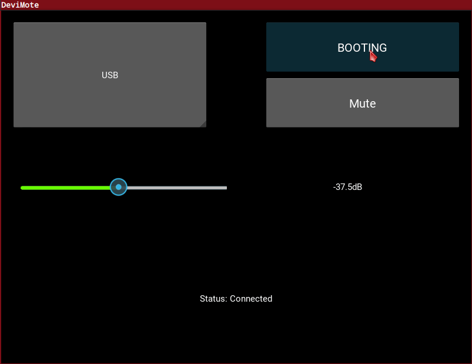

<!--
SPDX-FileCopyrightText: 2020-2026 Dimitris Lampridis <dlampridis@gmail.com>

SPDX-License-Identifier: CC0-1.0
-->

# DeviMote

Unofficial remote control for Devialet Expert (non-Pro) amplifiers written in Python.


The amplifier is controlled over UDP on the local network. There is no official API —
the protocol was reverse-engineered with Wireshark. "Non-Pro" means hardware from before
the Core Infinity board.

This repository provides three things:

- **`pydevialet_expert_nonpro`** — a small, dependency-free Python library implementing the
  UDP protocol. This is the publishable artifact, installable from PyPI and reusable by any
  application (CLIs, GUIs, Home Assistant, …).
- **A CLI** (`devialet`) — a command-line remote, installed as an optional extra.
- **A Kivy GUI** (`gui/devimote.py`) — the original graphical remote, now a thin consumer of
  the library. It is a standalone script and is *not* part of the published package.

## Library

```bash
pip install pydevialet-expert-nonpro
```

```python
from pydevialet_expert_nonpro import DeviMoteBackEnd

amp = DeviMoteBackEnd()             # or DeviMoteBackEnd(host="mydevialet.local")
status = amp.update()              # receive and decode one status broadcast
print(status["dev_name"], status["volume"])

amp.set_volume(-20.0)              # volume in dB (clamped at -10 dB)
amp.toggle_mute()
amp.toggle_power()
amp.set_output(2)                  # select input by channel index
```

`update()` returns the status dictionary (`dev_name`, `ip`, `ch_list`, `power`, `muted`,
`channel`, `volume`, `connected`, `crc_ok`). `DevialetExpertNonPro` is available as an alias
of `DeviMoteBackEnd`.

All calls are blocking; run them on a worker thread if you need async behaviour.

## CLI

Install the `cli` extra to get the `devialet` command:

```bash
pip install "pydevialet-expert-nonpro[cli]"
```

Or run without installing via `uv`:

```bash
uvx --from "pydevialet-expert-nonpro[cli]" devialet --help
```

```
Usage: devialet [OPTIONS] COMMAND [ARGS]...

Commands:
  status  Show current amplifier status
  volume  Set volume in dB
  mute    Toggle mute on/off
  power   Toggle power (on/standby)
  source  Select input source by name (case-insensitive partial match)
```

The CLI auto-discovers the amplifier by listening for its UDP broadcast. You can optionally
pin it to a specific device by setting `DEVIALET_IP` in a `.env` file (copy `.env.example`):

```bash
cp .env.example .env   # then edit DEVIALET_IP=<your-amp-ip>
```

```bash
devialet status
devialet volume -- -20.5   # use -- before negative values
devialet mute
devialet power
devialet source analog
```

### Session state

Each `devialet` invocation is a fresh process, but command packets carry a 16-bit
sequence counter. In testing, the amplifier also accepted commands when the counter was
reset to 0, so continuity does not appear to be required. As a safeguard, the CLI
keeps the counter continuous between invocations by persisting it to a small
per-amplifier-IP JSON file:

- **macOS**: `~/Library/Application Support/pydevialet-expert-nonpro/state.json`
- **Linux**: `$XDG_CONFIG_HOME/pydevialet-expert-nonpro/state.json` (defaults to
  `~/.config/pydevialet-expert-nonpro/state.json`)
- **Windows**: `%APPDATA%\pydevialet-expert-nonpro\state.json`

The path (and current counter) is also shown by `devialet status`. It's safe to delete
this file at any time; it will be recreated starting from 0 on the next command.

## GUI

The Kivy GUI is a standalone script. Install the project with the `gui` extra and run it:

```bash
pip install -e ".[gui]"
python gui/devimote.py
```



> [!NOTE]  
> the Kivy 2.3.1 dependency [does not install with Python 3.14](https://github.com/kivy/kivy/issues/9225). If you want to test/use the GUI, you must use Python 3.13 or earlier.

## Development

```bash
pip install -e ".[dev,cli,gui]"
pytest                                         # unit tests (no amplifier needed)
pylint src/pydevialet_expert_nonpro tests gui  # must stay at 10.00/10
reuse lint                                     # licensing compliance
```
